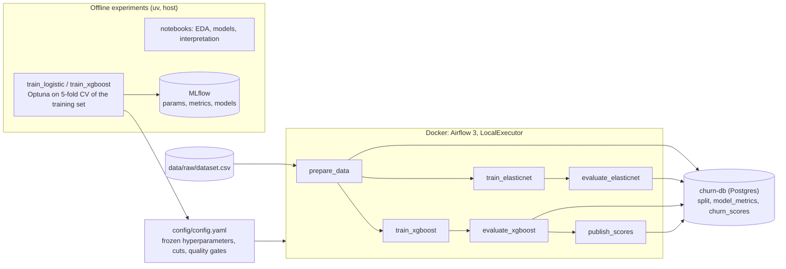

# Telco churn: drivers, model and weekly pipeline

Which customers of a telco are about to leave, and why. The project analyses the drivers of churn (globally and for a
single customer), compares an interpretable elastic-net logistic regression with XGBoost, and retrains and evaluates
both every week in an Airflow DAG running in Docker.

## Quickstart

Requirements: Docker Desktop (WSL2 backend on Windows) and [just](https://github.com/casey/just).

```bash
# 1. put the dataset (not in the repo) at data/raw/dataset.csv
# 2. build the image, start Airflow and the business database; the weekly DAG runs once on its own at the first start
just up
# 3. open http://localhost:8080 (airflow / airflow), or run the DAG again right away
just trigger
```

Without `just`: `docker compose up -d --build`, then trigger `churn_pipeline` from the UI.

Churn simulation API: http://localhost:8000/docs. `POST /customers/{customer_id}/simulate` with a `variable` and its
new `value` returns the hold-out customer's churn probability before and after the change.

## Architecture



- **Tuning is offline**: Optuna searches on 5-fold CV of the training set, tracked in MLflow. The DAG refits with the
  frozen values from config, so the weekly run takes under a minute.
- **One sklearn `Pipeline` per model**: cleaning, engineered features, encoding and model are fitted on the training
  rows only and pickled together, so scoring a new customer applies exactly the training-time preprocessing.
- **The DAG only orchestrates**: the logic lives in `src/churn/`. Tasks hand each other file paths through XCom, while
  the data stays on the shared volume. The split is stratified with a fixed seed, so every run holds out the same
  20% of customers.
- **Quality gate**: each evaluate task logs the hold-out metrics and fails if the PR-AUC drops below the CV mean minus
  2 fold standard deviations. Tasks retry once for transient errors; evaluate never retries, because a missed gate
  would only fail again. `publish_scores` runs only if XGBoost passes, so a worse model never reaches the
  retention list.

## Database

Airflow keeps its own metadata Postgres. The business data goes to a second Postgres, `churn-db`, with its own
credentials, so it can move to a managed database by changing one URL (`CHURN_DB_URL`). Open it with `just db`, or with
any SQL client on `localhost:5433` (user, password and database: `churn`).

| Table | Written by | Content |
|---|---|---|
| `split` | `prepare_data` (replaced) | Each customer and its set (train / test): an intermediate result to join other tables to |
| `model_metrics` | `evaluate_*` (appended) | One row per run and model: hold-out metrics, cut, quality-gate minimum, passed. Failed runs are recorded too |
| `churn_scores` | `publish_scores` (replaced) | The current list: churn probability, flag at the cut, the variable pushing the customer's risk up the most (TreeSHAP), and a suggested retention action for flagged customers |

```sql
-- Metric history across the weekly runs
SELECT run_id, model, pr_auc, roc_auc, passed FROM model_metrics ORDER BY evaluated_at DESC;

-- The 10 riskiest customers, with what to offer them
SELECT "Customer_ID", round(churn_probability::numeric, 2) AS risk, top_driver, suggested_action
FROM churn_scores WHERE flagged ORDER BY churn_probability DESC LIMIT 10;

-- How many flagged customers per retention action
SELECT suggested_action, count(*) FROM churn_scores WHERE flagged GROUP BY 1 ORDER BY 2 DESC;
```

The suggested actions come from `xgb.actions` in config: handset upgrade, renewal offer around the end of the first
year, proactive call when usage drops, plan review, review of the lines on the account. They are what the model
associates with each customer's risk, not a measured effect: an offer's real effect needs an A/B test.

## Repository

```
dags/churn_pipeline.py     the DAG (orchestration only)
src/churn/
  data.py                  loading, conformity cleaning, stratified split
  features.py              engineered features
  pipeline.py              production pipelines and DAG steps (runtime dependencies only)
  model.py                 CV, metrics, per-customer contributions, shared by notebooks and scripts
  train_logistic.py        elastic-net tuning tracked in MLflow (development)
  train_xgboost.py         XGBoost feature screening and tuning tracked in MLflow (development)
  eda.py, plots.py         EDA statistics and charts
config/config.yaml         paths, column lists, hyperparameters, cuts
notebooks/
  01_eda                   EDA on the training set
  02-03                    the final models: odds ratios (elastic net), SHAP (XGBoost)
tests/                     pytest
```

## Results

The hold-out set holds 20,000 customers; each model was chosen on CV before being scored on it.

| Model | CV PR-AUC | Hold-out PR-AUC | Hold-out ROC-AUC | Cut | Precision | Recall |
|---|---|---|---|---|---|---|
| Elastic net (interpretable benchmark) | 0.647 ± 0.005 | 0.651 | 0.668 | 0.50 | 0.62 | 0.61 |
| XGBoost (production) | 0.690 ± 0.006 | 0.690 | 0.699 | 0.43 | 0.60 | 0.78 |

- **The XGBoost cut** gives the highest out-of-fold recall with a precision of at least 0.6 on the training set.
- **The top 10% riskiest customers** churn at 80%, against 50% overall.

Main drivers (XGBoost, mean |SHAP| on the hold-out):
1. **Handset age** (`eqpdays`): the risk steps up at about 300 days.
2. **Recent usage drop** (`change_mou_pct`): minutes falling by more than half against the last three months.
3. **Tenure** (`months`): the risk peaks at months 11–12, the end of the first year.
4. **Usage against the customer's own lifetime average** (`mou_vs_lifetime`): the lower it is, the higher the risk.
5. **Subscribers in the household** (`uniqsubs`).

## Reading the metrics

The sample is balanced (~50% churners: 49.6% in the training set), which is far above a real monthly churn rate.
Precision, PR-AUC and the Brier score depend on that prevalence, so the values reported here do not represent the
real population: in production, at the same cut, precision would be lower (more false alarms per churner found)
and the probabilities would need recalibrating to the real churn rate. Recall and ROC-AUC do not depend on the
prevalence. Models are compared with each other on the same sample, never against figures from other datasets.

## Development

The Docker image installs only the runtime dependencies from `uv.lock`; notebooks, MLflow and Optuna are in the uv
dev group.

```bash
uv sync                  # development environment
just test                # pytest
just lint                # ruff
just mlflow-ui           # experiment runs on http://localhost:5000
just logistic            # re-run the elastic-net tuning (~15 min)
just xgb                 # re-run the XGBoost tuning (~30 min)
```
